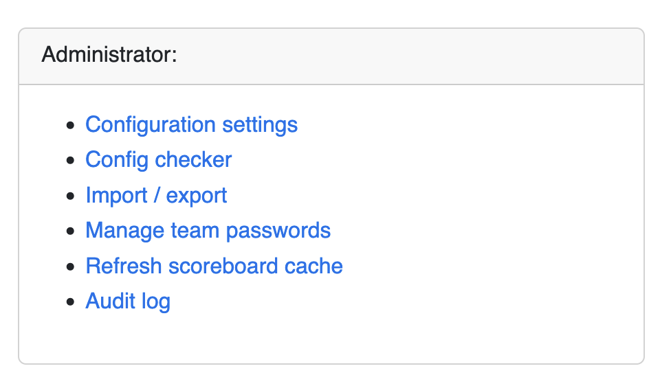
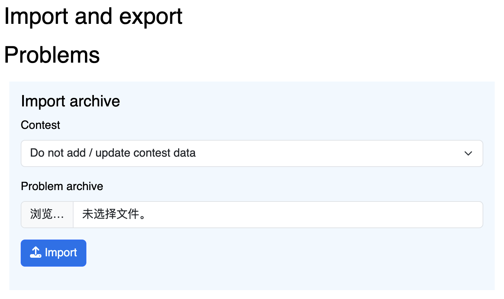
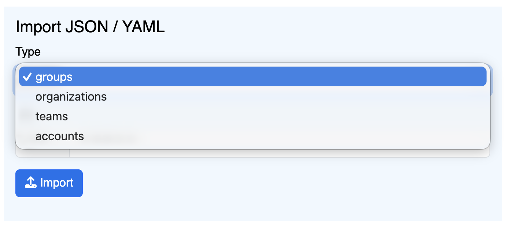

## 序言

做这个系列的初衷，还是希望能普及一下办赛知识以及让大家了解后台工作人员的辛苦。我不敢说我自己的技术水平有多高，但是从近几年我们学校的反响来看，我个人认为我办的比赛还是很不错的，不好说和 2026 深圳 inv 那样十全十美，但整体观感也很不错。下面是一些现场照片，你可以在我们 ACM 博客中找到它们。

如果你是一个老登但对如何开比赛有相关疑问，希望自己也能开一场完美的比赛，流程涵盖 命题格式，前期准备，气球发送，以及 IP 无缝登录，赛时大屏，滚榜，甚至后面我可能会写一个如何封装一个自己的操作系统。那这个教程可能很适合你，如果你是大手子，有对文章异议的，可以直接提出修改（在此感谢以 CSL 为代表的技术团队）。

如果对这个教程有任何问题，或者自己在配置的过程中出现无法解决的问题，欢迎私信我邮箱 timothystarman2005@outlook.com；由于 domjudge 中文交流群是邀请制，为了尊重社区意见，如果想要加入这个群，请在邮箱内说明邀请。

## 前期准备

### 物品

首先是关于物品的前期准备，这是我们学校在办赛的时候的标准，可以作为参考：

- 服务器，交换机，网线，选手机等基础设施，学校机房应该都有配备，如果社团没有自己的服务器（考虑企业赞助或者自己集资买一个），使用个人电脑作为服务器也是不错的选择。
- 打印机，小票机，以及其耗材，例如 A4 纸；如果是 3 人一队的比赛，打印机还是比较重要的，但是你说你们学校单人比赛？那打印机可以省了，但是如果大家需要气球分发，使用小票机是一个非常有必要的选择，它可以及时通知在场的志愿者，以及提供清晰的指向方便志愿者发送气球。
- 气球，电动打气工具，这不用多说了，如果要分发气球，建议买不同颜色的气球，这种东西就算一次性使用都可以用好几次比赛。打气工具建议是电动的，~~不然你将体会到什么是手巨酸还供应不过来~~。
- 插排，电源若干，多一点准备，少一点翻车。

### 题面排版

抛开命题质量，一个排版美观的题面是体现办赛专业性的关键因素，这里的技术栈可谓是种类繁多，我个人倒是比较喜欢使用 $\LaTeX$ 进行排版，后面我决定有些 attribute 对我来说不够用，遂自己做了一个 $\LaTeX$ 模板，支持的功能还是比较多的，甚至多测用虚线分割，如果你感兴趣，你可以在社团的 `git` 社区 https://git.jsut.site/tim/2026-jsutcpc 找到模板，使用 $\text{Lua}\LaTeX$ 编译。

此外，这里还有更通用的 [olymp.sty](https://github.com/GassaFM/olymp.sty) 可供使用，大家根据自己的喜好来。

### 邀请函

如果能发布邀请函，那也是一个不错的选择，如果把学校的比赛通知换成邀请函，那就更像 XCPC 赛事的组织了。

邀请函可以写一点报名指南以及报名方法，参考正式比赛的内容排版，这里就不多介绍，感兴趣的可以前往我们 ACM 社区查看邀请函内容。

有了上述的东西，我们就能愉快的开比赛啦！

## 赛前配置

### 系统安装

我们这里推荐使用 Debian 13 Trixie 为例，需要大家掌握该操作系统如何安装并能够成功进入 TTY 或 GUI 界面，如果你是初学者，那么还是建议使用 GUI 界面，但是后面的教程几乎都是命令为主，因为有些配置需要科学上网，所以有一个 GUI 界面会省事很多，~~但是你像我一样多个服务器走一个服务器的代理路由当我没说，主要难点就是命令行的科学上网~~。

此外，如果你害怕安装不对，你可以使用备份恢复或使用 BTRFS 格式回退指针恢复更改。同时需要你会使用 vim 工具。

### Domserver 配置

`Domserver` 是 `Domjudge` 的服务器兼前端工具，便于选手使用判题服务。我们这里使用全新的 Debian 13.4.0 开始配置，首先进入操作系统后请检查当前用户是否可以通过 `sudo` 提权，否则，将当前用户添加到 `sudoers`。

```bash
su
sudo usermod -aG sudo <username>
```

请将 `<username>` 更改为你要添加授权的用户名，最后使用 `exit` 退出 `root`。

接下来我们将 `apt` 源更改为国内镜像源，我比较喜欢 USTC Mirror，具体的使用方法可以参阅：https://mirrors.ustc.edu.cn/help/debian.html，这里我们使用 `nano` 更改 `/etc/apt/sources.list` 文件：

```bash
sudo nano /etc/apt/sources.list
```

然后删除所有内容，添加：

```bash
# 默认注释了源码仓库，如有需要可自行取消注释
deb http://mirrors.ustc.edu.cn/debian trixie main contrib non-free non-free-firmware
# deb-src http://mirrors.ustc.edu.cn/debian trixie main contrib non-free non-free-firmware
deb http://mirrors.ustc.edu.cn/debian trixie-updates main contrib non-free non-free-firmware
# deb-src http://mirrors.ustc.edu.cn/debian trixie-updates main contrib non-free non-free-firmware

# backports 软件源，请按需启用
# deb http://mirrors.ustc.edu.cn/debian trixie-backports main contrib non-free non-free-firmware
# deb-src http://mirrors.ustc.edu.cn/debian trixie-backports main contrib non-free non-free-firmware
```

最后保存文件，运行 `sudo apt update` 更新索引以生效。

接下来我们安装必要的工具，直接运行下面的操作即可：

```bash
sudo apt install libcgroup-dev make acl zip unzip pv mariadb-server nginx php php-fpm php-gd php-cli php-intl php-mbstring php-mysql php-curl php-json php-xml php-zip composer openntpd python3-yaml php-bcmath build-essential curl
```

接下来的安装步骤会分为两个派系：

- docker 派，比较无脑，一行命令解决，但是后续对接各种工具略有困难；
- 本机安装派，我非常大家使用这个方法，下面讲解也将用这个方法描述。

在自己的 `~` 目录下运行：

```bash
cd # 建议在 home 下
curl https://www.domjudge.org/releases/domjudge-9.0.1.tar.gz -o domjudge.tar.gz
tar -zxvf domjudge.tar.gz
cd domjudge-9.0.1
```

按照上述步骤安装所需软件后，运行 `configure` 命令。我们要将 DOMjudge 安装到 `/opt` 目录下的 `domjudge` 目录中：

```bash
./configure --prefix=/opt/domjudge --with-baseurl=127.0.0.1
make domserver
sudo make install-domserver
cd /opt/domjudge/domserver
sudo bin/dj_setup_database -s install
sudo ln -s /opt/domjudge/domserver/etc/nginx-conf /etc/nginx/sites-enabled/domjudge
sudo ln -s /opt/domjudge/domserver/etc/domjudge-fpm.conf /etc/php/8.4/fpm/pool.d/domjudge.conf
sudo service php8.4-fpm reload
```

最后两句 php 要换成对应的版本，我这里是 php8.4。

```bash
cd /etc/nginx/sites-enabled
sudo rm default
sudo service nginx reload
cd /opt/domjudge/domserver
sudo chown www-data:www-data -R webapp/public/*
```

最后，我们访问 `127.0.0.1/domjudge` 就可以了，然后你就可以通过 `admin` 为账号，密码可以在这里获取：

```bash
sudo cat /opt/domjudge/domserver/etc/initial_admin_password.secret
```

### 配置 php 和 mariadb

```bash
cd /etc/php/8.4/fpm/pool.d
sudo vim domjudge.conf
```

打开配置文件后找到 `php_admin_value[memory_limit]` 一栏，改成：

```bash
php_admin_value[memory_limit] = 1024M
```

再找到 `php_admin_value[date.timezone]` 一栏，改成：

```bash
php_admin_value[date.timezone] = Asia/Shanghai
```

使用 `wq` 保存并退出。

```bash
sudo service php8.4-fpm reload
sudo vim /etc/mysql/conf.d/mysql.cnf
```

你会看到一行 `[mysql]`，删掉。接着粘贴以下内容：

```
[mysqld]
max_connections = 1000
max_allowed_packet = 512MB
innodb_log_file_size = 2560MB
```

这只是示例，实际 `max_allowed_packet` 要改成两倍于题目测试数据文件的大小；`innodb_log_file_size` 要改成十倍于题目测试数据文件的大小。

保存退出。

```
sudo vim /etc/mysql/mariadb.conf.d/50-server.cnf
```

找到 `max_allowed_packet = 1G`，取消这一行的注释。并且在下面一行添加

```bash
innodb_snapshot_isolation=OFF
```

保存退出。

```
sudo systemctl restart mysql
```

如果一切正常，刷新 DOMjudge 的 web 页面，点进 config checker，若 php 和 db 没有任何问题就代表你成功了，否则检查前面的过程是否正确。

### 安装 JudgeHost

这一部分是安装判题机，~~可以说是相当复杂（其实也没复杂多少）~~，如果你害怕安装失败，请自行在关键步骤使用还原点。而且非常非常不建议使用 docker 安装，后面说具体原因。

首先依旧是依赖：

```bash
sudo apt install make pkg-config sudo debootstrap libcgroup-dev \
      php-cli php-curl php-json php-xml php-zip lsof procps gcc g++
```

同配置 domserver 一致：

```bash
cd ~/domjudge-9.0.1
./configure --prefix=/opt/domjudge --with-baseurl=127.0.0.1
make judgehost
sudo make install-judgehost
sudo cp judge/domjudge-judgedaemon@.service /etc/systemd/system/
sudo cp judge/create-cgroups.service /etc/systemd/system/
```

接下来，请根据自己的实际情况完成操作，下面的操作仅做参考，每个人的机子条件都不同！首先是查看 CPU 的在线线程。

```bash
cat /sys/devices/system/cpu/online
```

一般来说就是 $0\sim n$，如果你是虚拟机，那就是分配的核心数，主机的话就是这台电脑的核心数，理论上有多少核心就可以开多少个判题机，但不建议这么做。

首先创建 non-privileged user 组：

```bash
sudo groupadd domjudge-run
```

接下来我们尝试把判题机绑定编号为 2 的核心，即：

```bash
sudo useradd -d /nonexistent -g domjudge-run -M -s /bin/false domjudge-run-2
```

后缀 -2 表示将 judgedaemon 绑定到 CPU 核心 2，如果你想多开几个就修改这个绑定的核心然后运行上面的命令。

接下来，judgedaemon 会使用名为 runguard 的包装器来隔离编译或运行提交的程序。你需要将 runuser 添加到 sudoers：

```bash
sudo cp /opt/domjudge/judgehost/etc/sudoers-domjudge /etc/sudoers.d/
```

接下来需要创建一个 chroot 环境，如果你网络好，你可以直接运行 `/opt/domjudge/judgehost/bin/dj_make_chroot`，否则你可以选择编辑这个脚本，你可以通过更改里面出现的镜像源，即将

```bash
[ -z "$DEBMIRROR" ] && DEBMIRROR="http://deb.debian.org/debian"

${DISABLE_SECURITY}deb http://security.debian.org    $SECURITY_RELEASE    main
```

这两行所出现的进行更改，最后运行即可。下面是我的更改，使用 ustc mirror：

```bash
[ -z "$DEBMIRROR" ] && DEBMIRROR="https://mirrors.ustc.edu.cn/debian/"

${DISABLE_SECURITY}deb https://mirrors.ustc.edu.cn/debian-security/    $SECURITY_RELEASE    main
```

然后运行：

```sh
sudo /opt/domjudge/judgehost/bin/dj_make_chroot
```

### cgroups

关于这个问题就是为什么我不推荐使用 docker，docker 依赖于只读挂载的 cgroups，需要转换为 cgroups v1，而现在我们几乎所有的机子都使用 cgroups v2。

接下来运行 `sudo /opt/domjudge/judgehost/bin/create_cgroups` 脚本创建 cgroups。

### REST API 凭据

如果你的 domserver 与 judgehost 在同一台机子上，请忽略本操作。如果你的判题机在另一个机子上，你需要访问在 domserver 的机子上的凭据，即：

```bash
cat /opt/domjudge/domserver/etc/restapi.secret
```

然后在 judgehost 的机子上更改文件

```bash
default http://example.edu/domjudge/api/  judgehost  MzfJYWF5agSlUfmiGEy5mgkfqU
```

第二个 url 你可以在管理页面的 Config Checker 找到。

### 启动判题机

你可以使用 `systemd` 启动：

```bash
sudo systemctl start domjudge-judgedaemon@2
```

结尾的 2 表示启动第几个核心上的判题机（需要前文创建）。

接下来建议是保持电脑处于开机状态，如果关机的话再启动请依次执行下面两个命令：

```bash
sudo /opt/domjudge/judgehost/bin/create_cgroups
sudo systemctl start domjudge-judgedaemon@n # n 替换为核心号
```

## 上传问题

### 普通问题

上传一个普通问题的格式如下，其中输入一定是 `.in`，答案比对一定是 `.ans` 文件，具体的可以参阅 [icpc 问题规范](https://www.domjudge.org/docs/manual/9.0/problem-format.html)。确保上传的 `zip` 压缩包格式如下（注意不是直接压缩题目文件夹而是保证根目录下是这样的）。

```bash
A
├── data
│   ├── sample
│   │   ├── 1.ans
│   │   └── 1.in
│   └── secret
│       ├── 1.ans
│       ├── 1.in
│       ├── 2.ans
│       ├── 2.in
│       ├── 3.ans
│       ├── 3.in
│       ├── 4.ans
│       ├── 4.in
│       ├── 5.ans
│       ├── 5.in
│       ├── 6.ans
│       ├── 6.in
│       ├── 7.ans
│       ├── 7.in
│       ├── 8.ans
│       ├── 8.in
│       ├── 9.ans
│       ├── 9.in
├── domjudge-problem.ini
├── problem.pdf
└── problem.yaml
```

这是我的 `domjudge-problem.ini`：

```ini
timelimit='1'
```

其次是 `problem.yaml`

```yaml
name: Previously
limits:
  memory: 256
```

其实就差不多了，因为我们到这里还没有买气球，颜色什么属性暂时不在这里指定。

### special judge

Domjudge 支持任何语言的 `spj`，甚至是二进制文件，也就是说只要你满足规范返回值都可以被接受，但是我们这里还是很推荐大家使用 `testlib` 来编写 `spj`。

需要注意的是，Domjudge 需要使用修改后的 `testlib.h` 而非为 codeforces 准备的，有关 `testlib.h` 下载，可以在 https://github.com/cn-xcpc-tools/Polygon2DOMjudge/blob/master/p2d/testlib/README.md 找到，如果是特殊判题，需要你在 `problem.yaml` 中添加:

```yaml
validation: custom
```

文件格式如下：

```bash
.
├── data
│   ├── sample
│   └── secret
├── domjudge-problem.ini
├── output_validators
│   └── validate
│       ├── checker.cc			# .cc 就是 .cpp ~
│       └── testlib.h
└── problem.yaml
```

### 交互题

交互题也是同理，需要你在 `problem.yaml` 中添加:

```yaml
validation: custom interactive
```

文件格式如下：

```bash
.
├── data
│   ├── sample
│   └── secret
├── domjudge-problem.ini
├── output_validators
│   └── interactor
│       ├── interactor.cc
│       └── testlib.h
├── problem.pdf
└── problem.yaml
```

### 通信题

不会......Work In Progress.

### 上传文件

做好上述准备后，我们可以使用 admin 账户访问 DOMjudge Jury interface，选择 Import / export，即 `/jury/import-export`



由于我们一开始会有一个 demo contest，所以我们建议是将其上传到 Do not add / update contest data.



选择你刚刚打包的题目压缩包即可

## 导入队伍

这一部分如果你想要更深入的配置指南，参阅 [Adding contest data in bulk](https://www.domjudge.org/docs/manual/9.0/import.html#)。

### 确定队伍种类

一般来说，icpc 竞赛队伍种类有 3 种：

- 正式队伍
- 打星队伍
- 女队

下面我们建立一个 `groups.json` 列表对象来详细说明创建队伍种类：

```json
[
    {
        "id": "1",
        "name": "Participants"
    },
    {
        "id": "2",
        "name": "Girls"
    },
    {
        "id": "3",
      	"name": "Stars"
    },
  	{
      	"id": "0",
      	"name": "Observer",
      	"hidden": true	// 管理员使用，用于后台提交测试
    },
]
```

然后在 Import / export 上传：


### 隶属学校，机构，学院

下面我们建立一个 `organizations.json` 列表对象来创建学校：

```json
[
    {
        "id": "THU",
        "name": "THU",
        "formal_name": "Tsinghua University",
        "country": "CHN"
    },
    {
        "id": "CZU",
        "name": "CZU",
        "formal_name": "Changzhou University",
        "country": "CHN"
    },
    {
        "id": "JSUT",
        "name": "JSUT",
        "formal_name": "Jiangsu University of Technology",
        "country": "CHN"
    }
]
```

然后通过 Import / Export 上传，同上选择 organizations。接下来可以前往 Team Affiliations 界面，上传学校的校徽，机构 logo 等。如果要在榜单上显示 logo 而非国家国旗，你需要在 Configuration $\to$ Display $\to$ Show affiliations 选择 Yes，别忘记保存！

### 队伍

下面我们建立一个 `teams.json` 列表对象来创建参赛队伍（请根据实际报名情况修改添加）：

```json
[
    {
        "id": "1",
        "label": "A1",  //座位号，配置气球小票机很有用
        "group_ids": [
            "1"
        ],
        "name": "零基础新生一队",
        "organization_id": "THU"
    },
    {
        "id": "2",
        "label": "B2",
        "group_ids": [
            "2"
        ],
        "name": "wf 皇帝",
        "organization_id": "JSUT"
    }
]
```

然后通过 Import / Export 上传，同上选择 teams。

### 用户

我们需要为每一个队伍创建一个用户，下面我们建立一个 `accounts.json` 列表对象来创建参赛队伍的用户（请根据实际报名情况修改添加）：

```json
[
    {
        "id": "jsut-team-001",
        "username": "jsut-team-001",
        "password": "hfqifhew938",
        "type": "team",
        "team_id": "2",
        "name": "wf 皇帝"
    },
    {
        "id": "thu-team-001",
        "username": "thu-team-001",
        "password": "fh3uiyf92ui",
        "type": "team",
        "team_id": "1",
        "name": "零基础新生一队"
    }
]
```

然后通过 Import / Export 上传，同上选择 accounts。

至此，队伍这部分就结束啦！

## 配置比赛

在 DOMjudge Jury interface 选择 Contests $\to$ Add new contest 可以开比赛，在这一部分请你需要一点英文水平，在这个页面有很详细的英文注释，有些功能请按需启用。

或者你也可以上传 `json`，请记住你的比赛 `id`，后续配置比赛工具有用。

```json
{
    "id": "jsutcpc",
    "name": "Jiangsu University of Technology Collegiate Programming Contest",
    "start_time": "2026-05-23T13:00:00+08:00",
    "duration": "4:00:00",
    "scoreboard_freeze_duration": "1:00:00",
    "penalty_time": "20"
}
```

然后你可以前往在 DOMjudge Jury interface 选择 Contests $\to$ Edit 编辑，可以编辑参赛组别，评级选手以及打星 skip 等信息的。

## 配置 ICPC Tools

主要就是用来显示一些东西用的，包括 judge queue、scoreboard、大屏倒计时等等，总的来说配好了的话还挺有比赛氛围的。

### CDS

这是几乎所有 ICPC Tools 的前置工具，用于解析比赛数据的服务器，你可以在这里找到 https://tools.icpc.global/cds/。

运行这个工具需要使用 `Java` 我这里使用的是 `OpenJDK-21-JDK` 

```bash
sudo apt install openjdk-21-jdk
```

然后在你要运行 CDS 的服务器上下载这个 https://tools.icpc.global/cds/，然后解压即可，修改 `wlp/usr/servers/cds/config/cdsConfig.xml` 里面所有的内容替换成如下：

```xml
<cds>
    <!-- Set location= to a directory that the user running the CDS can write to -->
    <contest location="/home/<username>/contest-data" recordReactions="false">
        <!-- Set the url to the URL of your DOMjudge installation, followed by /api/contests/<cid>, where <cid> is your CID or external ID -->
        <!-- Set the user and password to the user you created in the previous step -->
        <ccs
            url="<domjudge url>/api/contests/<contest cid>"
            user="admin"
            password="yourpassword" />
    </contest>
</cds>
```

location 字段替换成一个不需要 root 就能访问或者修改的目录，例如你可以用 `<username>` 换成当前登录的用户。

url 字段按照上面的替换，例如我这里是 `http://127.0.0.1/domjudge/api/contests/jsutcpc`。

password 就是 admin 用户名的密码。接下来就可以运行（需要装 java jdk 11 或以上）

```bash
JAVA_HOME=/usr/lib/jvm/java-21-openjdk-amd64/ wlp/bin/server run cds
```

来启动 CDS 了，关闭的话直接 Ctrl+C 停止服务即可。

最后访问的是 `https://<server ip>:8443/` 即可。

### Presentation Admin / Client

这个东西算是最能体现参赛氛围的东西了，就是大屏展示。其中 Presentation Admin 我使用的是 Windows 系统配置，主要是操作方便（任何可以运行 Java 的系统都是可以使用的），在这里 https://tools.icpc.global/pres-admin/ 下载。

启动的话就使用

```bat
.\presAdmin.bat https://<server ip>:8443 presAdmin <presAdmin password>
```

如果是 `MacOS` 或 `Linux`，启动的 `.\presAdmin.bat` 改为 `.\presAdmin.sh` 即可。其中 presAdmin 还有其密码见 cds 的 users.xml，server ip 就是上面说的那个 ip:8443，然后会跳出一个管理界面，这就是管理 Client 的界面。

接下来就是配置 Client，下载地址在 https://tools.icpc.global/pres-client/；为了支持中文，需要将字体进行更改。例如我这里使用 Noto Sans SC（思源黑体），然后将字体 ttf 重命名改成 `Helvetica-Plain.ttf` 将 lib/presentations.jar 作为压缩文件打开，替换掉源文件的 /font/Helvetica-Plain.ttf。

然后启动就使用

```bat
./client.bat https://<server ip>:8443/api/contests/<cid> presentation <presentation password> --name <client name>
```

cid 就是上面 json 比赛文件指定的 id，例如我这里就是 `jsutcpc`，密码见 cds 的 users.xml，这样就可以启动氛围感超强的 Presentation 了。

## XCPC-Tools

这里是开源 github 界面 https://github.com/hydro-dev/xcpc-tools，这是一个比赛工具，可以帮助大家更加接近真实的比赛。

### 配置打印机 Server

如果是队伍参赛，配置打印机其实是必不可少的，这里建议使用 windows 系统作为打印系统，因为一些打印机在 linux 上的驱动支持不是很好，笔者这里使用的是 Canon LBP 6018L。

前往 release 页面下载可执行文件，如果你有 nodejs，可以下载 [xcpc-tools-bundle.js](https://github.com/hydro-dev/xcpc-tools/releases/download/1.1.0-dade98f/xcpc-tools-bundle.js)。首先我们这一接讲的是配置打印服务器，所以我们使用 linux 操作系统。

使用 `node ./xcpc-tools-bundle.js` 或直接执行二进制文件，在根目录下会产生 `config.yaml` 文件，我们编辑这个文件。

```yaml
type: domjudge # 选择 domjudge
viewPass: Y235H3gC # 设置一个管理员密码
secretRoute: ynKiOZv4IDwZ # 设置一个打印路由
customKeyfile: 
# if type is server, the following is not needed
server: http://127.0.0.1/domjudge
token: 
username: admin # domjudge 管理员
password: domjudge_admin_password # domjudge 管理员密码
monitor:
  timeSync: false

```

填写好配置重启后即可使用，程序默认监听 0.0.0.0 ，可通过 `http://服务IP:5283` 访问 UI 界面。服务用户名为 `admin` ，密码为填写的 `viewPass` 。

接下来下载打印脚本，https://github.com/hydro-dev/xcpc-tools/blob/main/scripts/print，我的建议是放在 /usr/local/bin 中，任何用户均可执行。

接下来打开 domjudge 并登录管理页面，选择 Configureation settings $\to$ External systems $\to$ Print command 加入 `print [file] [original] [language] [username] [teamname] [teamid] [location]` 为打印命令，其中 `file` 为代码文件路径，`original` 为原文件名，`language` 为语言，`username` 为用户名，`teamname` 为队伍名，`teamid` 为队伍ID，`location` 为选手位置；别忘记点击 Save all changes 保存设定。

### 配置打印机 Client

使用一台 windows 系统，运行 `node ./xcpc-tools-bundle.js --client`，由于 Windows 限制，在 Windows 下打印代码需要安装 `SumatraPDF` 用于打印 PDF 文件，如您的系统没有安装 `SumatraPDF` ，请根据提示下载便携版并放置于同一目录中；打印气球需将气球打印机设置为共享打印机，后续会自动检测。

Client 端的配置文件为 `config.yaml` ，配置文件介绍如下：

```js
const clientSchema = Schema.object({
    server: Schema.string().role('url').required(), // XCPC-TOOLS 服务地址
    balloon: Schema.string(), // 气球小票机路径或名称，请自行根据启动后的提示填写
    balloonLang: Schema.union(['zh', 'en']).default('zh').required(), // 气球小票语言
    balloonType: Schema.union([58, 80]).default(80), // 气球小票机纸张宽度
    printColor: Schema.boolean().default(false), // 是否打印彩色代码
    printers: Schema.array(Schema.string()).default([]).description('printer id list, will disable printing if unset'), // 打印机列表，如果为空则不启用打印功能
    token: Schema.string().required().description('Token generated on server'), // 服务端 Token
    fonts: Schema.array(Schema.string()).default([]), // 额外字体路径
});
```

需要注意的是，打印机列表请保留你要使用的打印机，把所有的打印为 PDF 都删掉，以及气球小票机也删除。

最后开一个比赛测试，看一个队伍 AC 后是否可以正常打印小票机，并且测试队伍是否可以打印以及信息是否正确。

## 滚榜 Resolver

首先我们先设置一个字体：为了支持中文，需要将字体进行更改。例如我这里使用 Noto Sans SC（思源黑体），然后将字体 ttf 重命名改成 `Helvetica-Plain.ttf` 将 lib/presentations.jar 作为压缩文件打开，替换掉源文件的 /font/Helvetica-Plain.ttf。

比赛结束后，首先在 DOMjudge 上 Finalize 这场比赛，之后浏览器访问以下网址：

```url
http://<domjudge url>/api/v4/contests/<cid>/event-feed?stream=false
```

创建一个文件夹叫做 `cdp/`，将 `event-feed.ndjson` 的文件，放在 cdp 文件夹的根目录下即可。

如果你想要自定义滚榜的图片，这里有一些参考：

```bash
.
├── config              // 非必需
│   ├── contest.yaml    // 从domjudge Import/export页面导出即可
│   ├── groups.tsv      // 从domjudge Import/export页面导出即可
│   ├── problemset.yaml
│   └── teams.tsv       // 从domjudge Import/export页面导出即可
├── contest
│   ├── banner.png      // resolver无用，但在cds放置于此就可显示banner
│   └── logo.png        // resolver主页面的图片&无照片队伍的默认照片
├── event-feed.ndjson   // 滚榜数据
├── groups              // Categories照片，但在resolver似乎没起到作用
│   └── 3               // Categories的id
│       └── logo.png
├── organizations       // Affiliations照片，只要某Affiliations的队伍有logo，其他同Affiliations的队伍就都是该logo
│   ├── 3000            // 该Affiliations所对应的任一队伍的icpc id
│   │   └── logo.png
│   ├── 3001
│   │   └── logo.png
│   ├── 3012
│   │   └── logo.png
│   ├── 3017
│   │   ├── country_flag.png    // 照源码里是这样放置的，但在resolver似乎没起到作用
│   │   └── logo.png
│   └── 3187
│       └── logo.png
└── teams               // 队伍照片
    ├── 3000            // 队伍的icpc id
    │   └── photo.png   // 照片名字固定是photo
    ├── 3001
    │   └── photo.png
    ├── 3009
    │   └── photo.png
    └── 3010
        └── photo.png
```

## References

https://vingying.github.io/2024/09/04/domjudge-icpctool/

https://github.com/hydro-dev/xcpc-tools

https://kisuraop.github.io/posts/4cf2169a.html

https://www.domjudge.org/docs/manual/9.0/index.html
